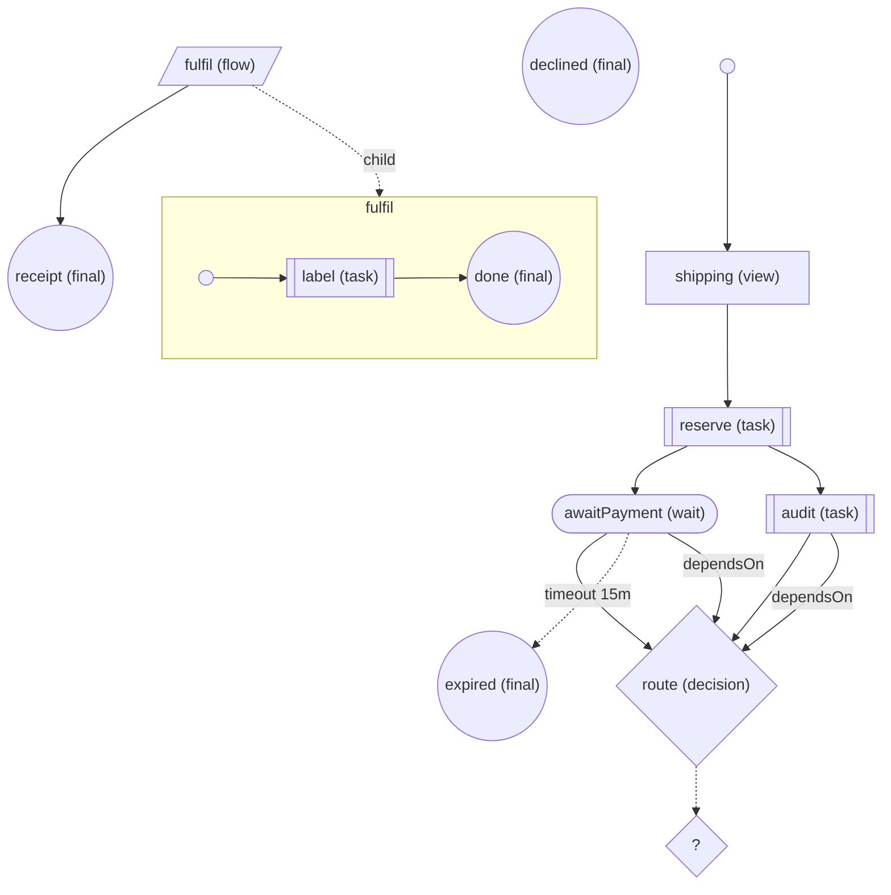

# 09: Mermaid (`toMermaid(inspect(flow))`)

`inspect(flow)` returns the static graph as data, and `toMermaid(graph)` turns that into a
Mermaid `flowchart TD` you can paste into any renderer or commit next to the flow. The checkout
in `src/checkout.ts` packs every static feature into one graph on purpose.

## How to read the output

| In the graph | What it means |
|---|---|
| a node labelled `id (kind)` | the step, shaped by its kind |
| a solid arrow | a `next` edge |
| an arrow labelled `dependsOn` | a data-readiness edge into a join |
| a dashed arrow labelled `timeout 15m` | a wait step's deadline |
| a dashed arrow to a `?` node | a decision whose `next` is a function, so the targets are not knowable statically |
| a `subgraph` | a nested flow, linked from its flow step, with ids made unique across levels |

## Run it

```sh
pnpm --filter example-09-mermaid start   # prints the Mermaid block
pnpm --filter example-09-mermaid check   # typecheck + vitest
```

## What the test proves

The test asserts the rendered text line by line and that rendering twice gives the same string,
so the output is safe to commit and diff. This is what `src/checkout.ts` renders:


