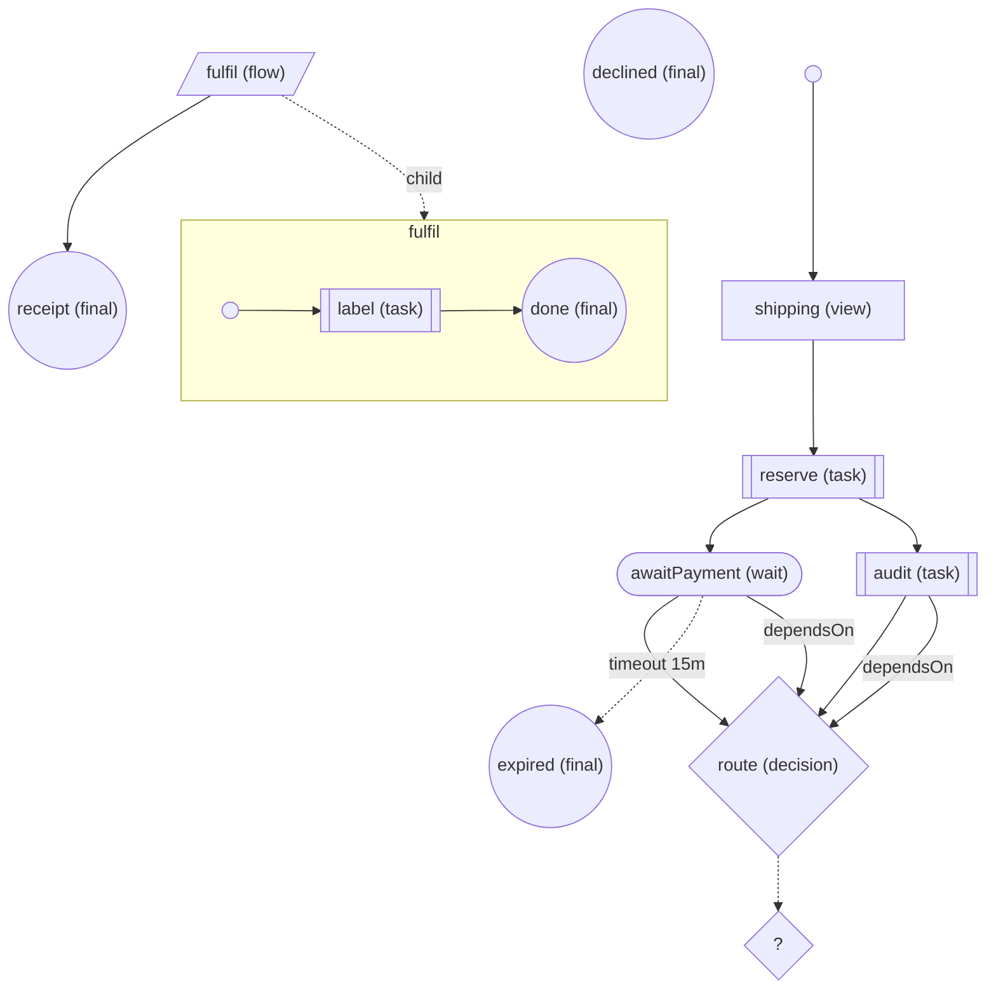

# 09 — Mermaid (`toMermaid(inspect(flow))`)

The static graph of a flow, rendered as a Mermaid `flowchart TD`. `inspect(flow)` is the data a
visualizer consumes (nodes, edges, warnings — child flows included); `toMermaid(graph)` turns it
into text you can paste into any Mermaid renderer or commit next to the flow.

What it shows

- Nodes are labelled `id (kind)` and shaped by kind: view `[…]`, task `[[…]]`, wait `([…])`, decision `{…}`, flow `[/…/]`, final `((…))`; a small circle marks each flow's `start`.
- Edges: solid `-->` for `next` (fan-out = several edges), `-->|dependsOn|` (`dependsOn (any)` for an OR-join) into a join, dashed `-.->|timeout 15m|` for a wait timeout, and a dashed edge to a `?` node for a decision whose `next` is a function (targets unknown statically).
- A nested flow is a `subgraph` (its own nodes, edges and start) linked from its flow step; ids are made Mermaid-safe (`fulfil__label`, reserved words such as `end` get a suffix) and stay unique across levels.
- Deterministic: the same graph always renders to the same text.

Run

```sh
pnpm --filter example-09-mermaid check
pnpm --filter example-09-mermaid start   # prints the ```mermaid block
```

Output (`src/checkout.ts`)


