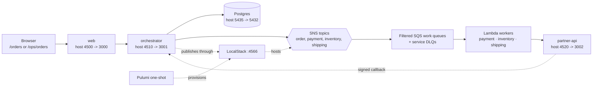

# Fulfillment reference system

This system runs an order workflow across a browser, an HTTP orchestrator, a
durable workflow runtime, a deterministic partner service, Postgres, and
LocalStack. Payment authorization and inventory reservation fan out together;
fraud review is a human checkpoint before capture; shipping ends in a signed
callback wait.

## Architecture

```text
browser
  |
  v
web :3000 ------------------------------ host :4500
  |
  v
orchestrator :3001 --------------------- host :4510
  |                 |                 |
  | SQL             | SNS             | signed callback
  v                 v                 ^
Postgres :5432   LocalStack :4566   partner-api :3002
                  |                 host :4520
                  +-- topics: order, payment, inventory, shipping
                  +-- filtered SQS work queues + DLQs
                  +-- Lambda workers + SQS event-source mappings
```



The web container proxies `/api` to the orchestrator. The orchestrator owns
authentication, tenant lookup, run snapshots, idempotency, projections, and
the partner callback endpoint. Pulumi provisions the LocalStack resources in a
Compose one-shot before the orchestrator starts. The partner API is a local,
deterministic stand-in; it never calls a payment, warehouse, or carrier
provider.

Pulumi creates these physical resources:

- SNS topics `fulfillment-order`, `fulfillment-payment`,
  `fulfillment-inventory`, and `fulfillment-shipping`.
- One `fulfillment-{payment|inventory|shipping}-work` queue and matching
  `-dlq` per service. Subscriptions use `eventType` message-attribute
  filters and `rawMessageDelivery=false`.
- Lambda workers `fulfillment-{payment|inventory|shipping}-worker`, each
  mapped to its work queue with batch size 10, a one-second batching window,
  and `ReportBatchItemFailures`.

Work queues have a 120-second visibility timeout and redrive after five
receives. The worker timeout is 15 seconds, so the queue has at least six times
the worker timeout. A malformed or repeatedly failing message remains in its
service DLQ for inspection.

## Start from a clean checkout

Run this exact command from `systems/03-fulfillment`:

```sh
docker compose up --build
```

Compose starts Postgres and LocalStack, runs the Pulumi deployment once, and
then starts the application containers. The Pulumi container uses the file
backend at `/state` and LocalStack credentials only. It does not contact AWS.

| Service | Host port | Container port | Purpose |
| --- | ---: | ---: | --- |
| web | 4500 | 3000 | customer and operator browser |
| orchestrator | 4510 | 3001 | REST API and workflow runs |
| partner-api | 4520 | 3002 | payment, inventory, and shipping fixture |
| Postgres | 5435 | 5432 | snapshots, inbox, audit, and orders |
| LocalStack | 4566 | 4566 | SNS, SQS, Lambda, IAM, logs, and STS |

Inside Compose use `web:3000`, `orchestrator:3001`, `partner-api:3002`,
`postgres:5432`, and `localstack:4566`.

## Seed and reset

Compose sets `SEED_ON_START=true`, so the first healthy orchestrator start seeds
stable local accounts and scenarios automatically. To rerun the idempotent seed
after a test, use:

```sh
pnpm seed
```

The seed is repeatable. It creates the normal order and a fraud-hold order
needed by the browser drill, and reuses stable idempotency keys. The local
tokens are:

| Token | Role | Tenant | Subject |
| --- | --- | --- | --- |
| `customer-acme` | customer | `tenant-acme` | `customer-alice` |
| `operator-acme` | operator | `tenant-acme` | `operator-olivia` |
| `customer-globex` | customer | `tenant-globex` | `customer-gary` |
| `operator-globex` | operator | `tenant-globex` | `operator-gabriel` |

Acme and Globex operators can inspect only their own tenant. A customer or
operator token cannot read an order owned by another tenant.

Reset only this system's named volumes and recreate the stack:

```sh
pnpm reset
docker compose up --build
# optional, idempotent rerun:
pnpm seed
```

The reset removes no source files, images, or volumes belonging to another
Compose project.

## Workflow and fraud drill

1. `POST /api/customer/orders` authenticates the customer and starts the run.
2. Payment authorization and inventory reservation publish work in parallel.
3. The join waits for both results. A branch failure compensates completed
   effects in reverse order.
4. The run enters fraud review before payment capture.
5. Approval captures payment, requests shipping, and waits for the partner
   callback. Rejection voids authorization and releases inventory.
6. A current, signed shipment callback completes the run and exposes tracking
   in the customer projection.

Open the Acme operator view and select the seeded fraud-hold order. Approve it
to continue toward shipping, or reject it to exercise compensation. Repeating
the decision, queue delivery, or callback is safe because the command and
event IDs are durable. An older task token, stale callback, malformed message,
wrong tenant, or wrong order correlation is ignored or rejected at its owning
boundary.

### Browser walkthrough

1. Open `http://localhost:4500/orders` as the customer. The live Compose build
   uses `customer-acme` by default. Create an order or select the seeded normal
   order, then refresh to watch the parallel payment and inventory branches.
2. Open `http://localhost:4500/ops/orders` in a second browser context. The
   live build uses `operator-acme`; select the fraud-hold order from the Review
   queue and inspect its branch and retry details.
3. Approve to capture payment and request shipping, then refresh the customer
   view after the signed callback. Reject instead to see authorization void and
   inventory release compensation.
4. For an API tenant-isolation check, use `operator-globex`; its list must not
   contain Acme orders, and an Acme order detail must return `404`.

Reference captures are committed with the public reference:

- [Customer orders](docs/screenshots/customer-orders.png) - customer order
  list, progress branches, status, and tracking.
- [Operator control room](docs/screenshots/operator-control-room.png) - queue
  filters, fraud review, branch attempts, and compensation detail.

The user-facing routes are:

```text
/api/customer/orders
/api/customer/orders/:id
/api/customer/orders/:id/cancel
/api/operator/orders
/api/operator/orders/:id
/api/operator/orders/:id/fraud/approve
/api/operator/orders/:id/fraud/reject
/api/webhooks/partner
/health
```

Customer JSON is a deny-by-default projection. It contains order status,
line items, totals, and tracking, never provider references, payment data,
signing secrets, queue payloads, or stack traces. Operator JSON includes the
extra workflow and compensation detail needed for operations.

## Tests

Fast tests use the production `fulfillmentWizard`, typed fake effects, a fake
clock, and in-memory snapshots:

```sh
pnpm test
pnpm typecheck
```

With Compose healthy, force the real service checks explicitly:

```sh
pnpm test:integration
```

The integration config sets `FULFILLMENT_INTEGRATION=1`; a missing stack is a
failure, not a silent skip. It checks REST policy and malformed input, real
Postgres tables and idempotency constraints, signed callback replay and
tenant/correlation checks, and real LocalStack topics, filtered queues, DLQs,
and Lambda workers. Unit queue tests cover duplicate, out-of-order, stale, and
malformed work without Docker.

For the browser journey, install Chromium once and run against the running
web container:

```sh
pnpm exec playwright install chromium
pnpm test:e2e
```

The Playwright contract lives at
`tests/e2e/customer-operator.spec.ts`: the Acme customer creates an order,
the workflow reaches the fraud checkpoint, and the Acme operator approves it.

## LocalStack and Pulumi

Compose pins `localstack/localstack:4.4.0`, the last account-free community
image used by this stack. Newer 2026 images require account activation, so do
not change the pin casually. The Lambda runtime also needs the Docker socket
and `LAMBDA_DOCKER_NETWORK=openwizard-fulfillment` so workers can resolve the
Compose services.

For a local-only preview without the application containers, start LocalStack
on port 4566 and run:

```sh
pnpm --dir infra local:preview
```

The helper selects `pulumilocal`, stores state in `infra/.pulumi`, sets a
file backend, and supplies test credentials. It must not read cloud credentials
or contact a real AWS endpoint. Compose uses the same program with its file
backend mounted at `/state`. See the [LocalStack Pulumi path](https://docs.localstack.cloud/aws/connecting/infrastructure-as-code/pulumi/),
[LocalStack Lambda networking](https://docs.localstack.cloud/aws/services/lambda/),
[LocalStack configuration options](https://docs.localstack.cloud/aws/customization/configuration-options/),
[Pulumi file backends](https://www.pulumi.com/docs/iac/concepts/state-and-backends/),
and [SNS subscription filters and redrive](https://www.pulumi.com/registry/packages/aws/api-docs/sns/topicsubscription/).

For the workflow runtime itself, see the [OpenWizard repository](https://github.com/abcdmku/wizard)
and its [official documentation source](https://github.com/abcdmku/wizard/tree/main/packages/docs/pages).

## Troubleshooting

- `pulumi` exits: run `docker compose logs pulumi localstack`. LocalStack
  must be healthy at `http://localstack:4566` from inside Compose. If a new
  image asks for account activation, restore the pinned `4.4.0` image.
- `orchestrator` is unhealthy: run
  `docker compose logs postgres orchestrator`; it waits for migrations and a
  healthy database.
- No queues or workers appear: run
  `docker compose exec localstack awslocal sqs list-queues` and inspect
  `docker compose logs pulumi localstack`; do not run a second Pulumi
  deployment while Compose is active.
- A callback returns `401`: sign the exact UTF-8 request bytes with
  `local-partner-webhook-secret` and use a fresh timestamp and message ID.
- The fraud order is stuck: use `operator-acme`, refresh the operator view, and
  inspect the payment, inventory, and shipping queues and their DLQs.
- Playwright cannot connect: wait for `http://localhost:4500` and rerun the
  command. The browser spec assumes the stack is already running.

## Change drill and DX budget

A workflow change normally updates the wizard test, the relevant contract/type
test, the projection serialization assertion, and the browser assertion when
the user-visible path changes. Keep each handwritten source or test file below
300 lines and aim for five changed files or fewer for a normal change.

Run `pnpm dx:audit` and record the duration and changed file count with a
change. The local targets are under 10 seconds for fast tests and under 90
seconds for a warm Compose suite. The block-size review and current measured
line counts are in [docs/dx-evaluation.md](docs/dx-evaluation.md).
