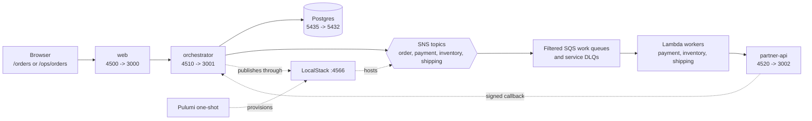

# Fulfillment architecture

## Service ownership

```text
browser
  |
web :3000 -- HTTP /api --> orchestrator :3001
                              |       |
                              | SQL   | SNS publish
                              v       v
                         Postgres   LocalStack :4566
                              ^       |
                              |       +-- SNS topics
                              |       +-- filtered SQS work queues
                              |       +-- service DLQs
                              |       +-- Lambda event mappings
                              |       ^
                              |       |
partner-api :3002 <-----------+-------+ worker HTTP
       |
       +---- signed callback /api/webhooks/partner
```



Host ports are web `4500`, orchestrator `4510`, partner API `4520`, Postgres
`5435`, and LocalStack `4566`. Inside Compose use web `3000`, orchestrator
`3001`, partner API `3002`, Postgres `5432`, and LocalStack `4566`.

The web app owns browser state and role-specific screens. The orchestrator owns
authentication, tenant lookup, workflow runs, snapshots, projections, durable
commands, and callback verification. Postgres owns order records, snapshots,
dedupe, timers, and callback audit. The partner API is deterministic local
behavior for payment, inventory, and shipping. Pulumi is a Compose one-shot
that provisions LocalStack before the orchestrator starts.

The orchestrator derives tenant identity from the verified principal. It passes
that identity to every repository lookup, command, callback, and projection.
Every order, run, inbox row, queue message, and idempotency record carries a
tenant ID.

## AWS-shaped local topology

Pulumi creates:

- SNS topics `fulfillment-order`, `fulfillment-payment`,
  `fulfillment-inventory`, and `fulfillment-shipping`.
- Payment, inventory, and shipping `-work` queues plus matching `-dlq` queues.
- SNS subscriptions with `rawMessageDelivery=false`, scoped to the
  `eventType` message attribute, and a filter containing only that service's
  event types.
- One Lambda per service, mapped to its work queue with batch size 10, a
  one-second batching window, and `ReportBatchItemFailures`.

The work queue visibility timeout is 120 seconds, the Lambda timeout is 15
seconds, and redrive starts after five receives. This gives a worker at least
six times its timeout to finish or report a failure. The LocalStack container
mounts the Docker socket and sets
`LAMBDA_DOCKER_NETWORK=openwizard-fulfillment`; without that network the Lambda
containers cannot resolve `partner-api` or `orchestrator`.

The local Compose image is pinned to `localstack/localstack:4.4.0`. This is the
last account-free community image used by the system. Newer 2026 images require
account activation and are not a drop-in replacement for this local path.

## Workflow graph

```text
receive order
  +-- authorize payment --+
  +-- reserve inventory --+--> join --> fraud review
                                      |       |
                                      |       +-- reject --> void/release compensation
                                      v
                                capture payment
                                      |
                                request shipment
                                      |
                                wait for signed carrier callback
                                      |
                                     done
```

Payment authorization and inventory reservation start together. The join waits
for both. If either branch fails, completed effects unwind in reverse completion
order. Fraud review runs before capture so rejection can void authorization and
release stock without refunding a captured payment. Shipping is idempotent and
ends in a wait; the callback completes the run only after signature, timestamp,
tenant, order, and event checks pass.

The domain exports `fulfillmentFlow`, a wizard built with
`defineWizard(options, ({ step, steps }) => steps(map, { start: 'begin' }))`.
The callback passes its bound `step` constructor to the readiness and delivery
modules so those modules share the context, dependency, and event types.
`fulfillmentFlow.create(context, { deps })` creates a run;
`fulfillmentFlow.resume(snapshot, { deps })` restores one. Projections and the
durable registry consume that same wizard.

Static `next` edges activate the parallel branches. The readiness join `needs`
both branch-completion nodes, so it waits until both are done. Fraud review returns
`{ done: decision }`; its `next` callback reads the updated context and chooses
one of the declared `targets`. Timeout edges lead to explicit failure steps.
The final `complete` step returns the order and shipment IDs as its run output.

## Boundary rules

The HTTP boundary authenticates the caller, decodes the command, applies the
role policy, and only then opens a tenant-scoped run. The workflow boundary
parses context, task outputs, and external events. The queue boundary validates
the SNS envelope and service filter before calling a partner. The callback
boundary verifies the exact signed bytes, timestamp, message ID, tenant, order
correlation, and current run state.

The customer projection is deny by default. It includes order status, line
items, totals, branch summaries, and tracking. The operator projection may
include fraud codes, provider references, retries, and compensation status.
Neither projection includes payment credentials, signing secrets, queue
payloads, database secrets, or error stacks. Tests serialize the JSON to catch
nested leaks.

## Callback and restart handling

Before a callback is applied, the handler validates:

- the signature over the exact request bytes;
- the envelope and event body;
- tenant and order correlation;
- the message ID and current run state in the inbox.

Only after those checks does it send the typed event to the run, commit the
snapshot, and publish the projection.

Customer cancellation and fraud decisions use `host.dispatch` with a command
ID and a digest of the caller's data. A replay returns the recorded command
result; changed data under the same ID is a conflict. Fraud decisions also
carry the observed version so concurrent decisions cannot both apply. Partner
callbacks use `host.send` with an `eventId`. The run records that ID in the
snapshot before effects run, and a redelivery returns `duplicate: true`.

The snapshot is authoritative. On restart, Postgres restores the run and bumps
the epoch. Retry deadlines and wait deadlines are re-armed. An in-flight result
with an old task token becomes an ignored stale result. An idempotent task may
run again with its original key. A duplicate queue delivery or callback is
acknowledged without a second state transition.
