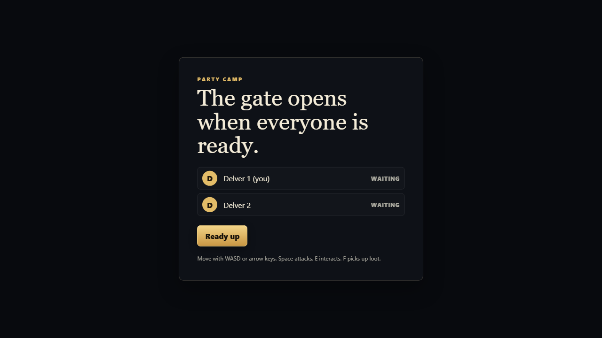
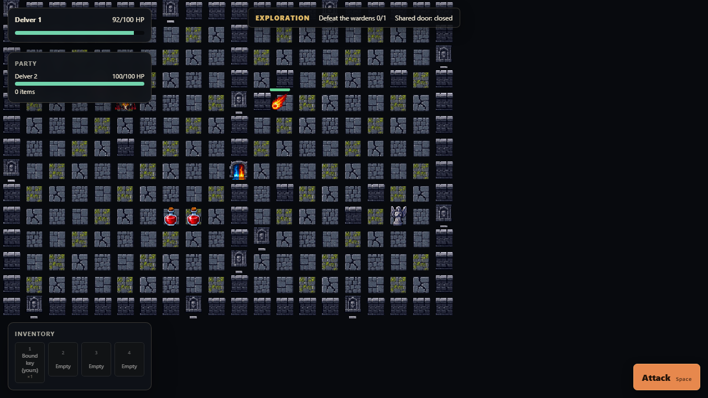
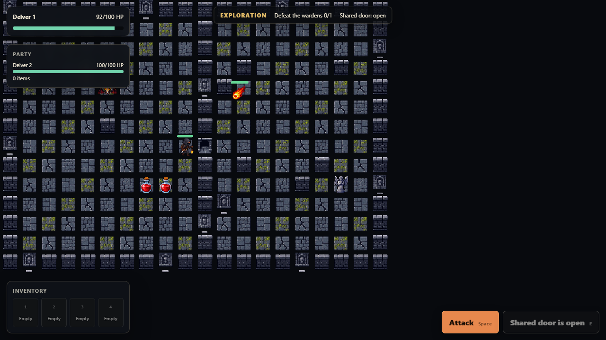

# Dungeon reference system

Dungeon is a small multiplayer room with an authoritative server. The browser
draws the last server frame and sends commands. The server owns movement,
combat, loot, room phases, and the rules for player-bound items. Postgres keeps
room state and command idempotency records across a restart.

## Run it

Requirements: Docker with Compose v2 and Node 20 or newer. Install k6 only for
the load commands. From this directory:

```sh
cp .env.example .env
docker compose up --build
```

Open <http://localhost:4400>. The service endpoints are:

| Service | URL | Purpose |
| --- | --- | --- |
| web | http://localhost:4400 | Browser client and WebSocket proxy |
| dungeon-api | http://localhost:4410 | REST API and health endpoint |
| postgres | localhost:5432 | Local database, when host access is needed |

Check both application containers with:

```sh
pnpm health
```

The Compose health checks wait for Postgres, the API, and the web server. The
API is reachable as `dungeon-api:8080` inside the `dungeon` network. The alias
`dungeon-server` is kept for the WebSocket client contract.

Host-side commands read `.env` from this directory. An explicitly exported
variable wins over the file. To use another file, set `DUNGEON_ENV_FILE` before
the command; relative paths resolve from this directory.

## Seeded player tickets

In another terminal, seed the repeatable local fixture:

```sh
pnpm seed
```

The seed endpoint is protected by `DUNGEON_SEED_KEY`. Dungeon uses short-lived
signed player tickets instead of a password form. `pnpm seed` prints a browser
URL for each seeded player. The URLs expire after ten minutes; rerun the seed
command when a ticket expires.

| Ticket ID | Name | Use |
| --- | --- | --- |
| player-one | Mira | Own the bound key |
| player-two | Tarin | Verify another player cannot use it |

The seed creates the starter room, a locked door, and one player-bound key. It
is safe to run more than once for the same `starter-party`; the API reuses the
durable party record instead of creating a second room.

To remove only this system's containers and database volume:

```sh
pnpm reset
docker compose up --build
pnpm seed
```

`pnpm reset` never removes images or files. It uses the named volume and network
declared in `compose.yaml`, so do not replace it with a broad `docker system
prune` command.

## Player-bound key walkthrough

1. Seed the fixture and open two browser windows at `http://localhost:4400`.
2. Open the printed `player-one` and `player-two` URLs in separate windows.
3. Start or join the starter room. Both players choose **Ready**. The server
   advances the room from `lobby` to `generated` and then `exploration`.
4. Move player one to the glowing bound key and choose **Pick up**. The private
   inventory shows `bound-key` with its owner. The public frame exposes only a
   public item count, never another player's private inventory.
5. Try the same pickup or door command as player two. The server rejects it and
   does not add an item to player two's private inventory. The rejection must
   not change the room sequence.
6. Use the key as player one on the locked door. The server accepts one command,
   opens the door, and broadcasts the next authoritative frame. Retrying the
   same command ID returns the saved result instead of opening the door again.
7. Stop the API container, start it again, and reconnect both browsers. The key
   owner and door state come from Postgres, not browser storage.

The browser receives full world frames over `/ws`. REST requests use `/api/` or
`/v1/` through the web proxy, and direct API calls use port 4410. A frame has a
monotonic `sequence`; clients discard stale frames and render 120 ms behind the
receive clock to hide jitter.

## Local pixel art

The renderer ships an original 512×512 RGBA sprite atlas at
[`web/public/assets/dungeon-atlas.png`](web/public/assets/dungeon-atlas.png).
Its checked-in [coordinate map](web/public/assets/dungeon-atlas.json) divides
the sheet into 256 32-pixel cells covering terrain, four-direction heroes,
monsters and the final boss, doors and keys, loot, consumables, projectiles,
and effects. The artwork was made for this reference app and needs no runtime
CDN or third-party asset license.

## Commands and checks

```sh
pnpm typecheck
pnpm test
pnpm test:integration
pnpm exec playwright install chromium
pnpm test:e2e
pnpm test:load
pnpm test:load:soak
pnpm test:ops
pnpm check:dx
```

`pnpm test` runs the unit project. `pnpm test:integration` starts a fresh
Compose stack, waits for `/health`, seeds it, and runs `tests/integration`.
The integration script uses a run-scoped Compose project, Postgres volume, and
network, even when `.env` names the main development resources. It removes only
those integration resources when it exits unless `DUNGEON_KEEP_STACK=1` is set.
Use `DUNGEON_INTEGRATION_PROJECT`, `DUNGEON_INTEGRATION_DB_VOLUME`, or
`DUNGEON_INTEGRATION_NETWORK_NAME` for an explicit integration override; an
override that matches the main resource is rejected. The default k6 run is a
short smoke check; the explicit soak command runs for five minutes.

CI can start Compose once, then use `pnpm ci:integration` and
`pnpm ci:browser`; both commands assume the stack is already healthy. The
browser gate runs the same journey sequentially with two and four players.
`DUNGEON_E2E_PLAYERS=2..4` selects one party size when invoking
`pnpm test:e2e` directly; only the canonical two-player run writes public
evidence screenshots.

Tracked green load evidence now covers the 250 ms diagnostic, the short 100 ms
profile, and the official five-minute profile. The
[canonical evidence manifest](load/evidence/manifest.json) records the exact
revision, dirty marker, images, result, and thresholds for each run. Capture
rejects red or malformed input before it can replace an existing green entry.

Keep handwritten source and test files at or below 300 lines. A player-bound key
change should normally touch no more than six files. Record the measured
change in [the DX audit](docs/dx-audit.md) and keep `dx-metrics.json` valid.

## Public references

- [Architecture and data boundaries](docs/architecture.md)
- [Playable walkthrough](docs/walkthrough.md)
- [Troubleshooting](docs/troubleshooting.md)
- [Browser evidence and capture details](docs/assets/README.md)
- [Canonical green load evidence](load/evidence/manifest.json)
- [Lobby](docs/assets/dungeon-lobby.png)
- [Private bound key](docs/assets/dungeon-bound-key.png)
- [Restart and reconnect](docs/assets/dungeon-reconnect.png)
- [PixiJS](https://pixijs.com/)
- [OpenWizard package and API docs](../../docs/)







## API reference

The API exposes these stable boundaries:

```text
GET  /health
POST /seed              (local seed key required)
GET  /ws?token=...      (WebSocket upgrade)
```

Commands carry a client-generated `commandId`. The server validates the player
and room before applying a command, stores the result, and returns the stored
result for a duplicate `commandId`. The server never trusts a player ID sent by
the browser when it conflicts with the authenticated session.

## Troubleshooting

`dungeon-api` never becomes healthy: run `docker compose logs postgres
dungeon-api`. The API waits for Postgres and migrations. Check that
`DUNGEON_POSTGRES_PORT` is not already in use, then run `pnpm reset` and start
again.

The page loads but the room stays empty: run `pnpm seed`, then inspect
`docker compose logs dungeon-api`. A seed request must include the local seed
key and a JSON body. Browser storage cannot create a room.

The WebSocket fails to connect: confirm `http://localhost:4400/health` and
inspect `docker compose logs web dungeon-api`. The web container proxies `/ws`
to `dungeon-api:8080` on the private network. Do not point a browser at the
container name.

The API returns a bound-item rejection: sign in as player one. The key is
intentionally private. A successful player-two request would be a server bug,
not a stale browser frame.

Playwright cannot connect: leave Compose running, check `pnpm health`, and use
`DUNGEON_WEB_URL` if the web port was changed. Playwright does not start Docker.

To inspect a failed integration run, set `DUNGEON_KEEP_STACK=1`, rerun
`pnpm test:integration`, and then use the run-scoped Compose project in the
printed `docker compose logs` command. The runner prints an exact
`DUNGEON_INTEGRATION_PROJECT=... DUNGEON_INTEGRATION_DB_VOLUME=...
DUNGEON_INTEGRATION_NETWORK_NAME=... pnpm reset:integration` cleanup command;
run that command after collecting logs. Do not use `pnpm reset` for a kept
integration stack because it targets the main development project.
