# Dungeon architecture

The browser is a view of server state. It does not decide whether a player can
move, pick up loot, open a door, or advance a room. One Wizard instance owns one
party. The API authenticates each command, turns it into a typed Wizard event,
and sends it to that party's durable run.

```mermaid
flowchart LR
  browser["Browser<br/>React + Pixi"]
  proxy["Web nginx :4400<br/>static + /api + /v1 + /ws"]
  api["dungeon-api :8080<br/>authenticated command ingress"]
  wizard["One Wizard per party<br/>10 Hz tick + durable waits"]
  host["DurableRunHost<br/>CAS + dedupe + active-party boot registry"]
  db[(Postgres :5432<br/>snapshots + commands)]

  browser -->|HTTP /api or /v1| proxy
  browser <-->|WebSocket /ws| proxy
  proxy -->|private dungeon network| api
  api -->|typed events| wizard
  wizard --> host
  host <-->|snapshot + command CAS| db
```

## Boundaries

The API has four checks before a command reaches the room loop:

1. Parse the authentication token and derive the player ID from it.
2. Decode the command and validate its `commandId`, room ID, and payload.
3. Load the room and verify that the authenticated player belongs to it.
4. Apply the transition in the room's serialized order, then write the result.

The transition can change private inventory and public world state. The
serializer keeps those views separate. A bound key includes its owner in the
private `self` view and is represented by `publicItemCount` for teammates. A
teammate never receives another player's inventory or effects. The server
checks the owner again when the key is used.

## WebSocket frames

Frames contain a monotonic `sequence`, `sentAt`, room phase, public
players/enemies/loot/fixtures, objective progress, and the recipient's private
inventory. The client drops a frame whose sequence is not newer than the last
accepted frame. It keeps a 24-frame buffer and samples 120 ms behind the receive
clock. The server remains authoritative when the client reconnects.

Each socket gets its own viewer-scoped `PlayerSource`. The source starts from
the runtime's last durably visible world, sequence, and epoch. It publishes a
new projection only after the fenced persistence barrier succeeds. Direct
snapshot requests and the explicit snapshot sent after a command ACK use the
same durable view. A late same-player socket and a reconnect therefore start
with a full durable snapshot, never the interpreter's candidate state. A CAS
conflict or lease loss publishes no candidate frame and closes bound sockets
with code 1012.

The full-frame size is part of the DX audit. The canonical four-player fixture
is 2,867 bytes, 11.5% of the 25,000-byte trigger. The official five-minute run
observed a 3,012-byte maximum frame and a 171 ms command-to-frame p95. The wire
contract reserves a patch variant with a base sequence, but the server does not
emit it while both triggers remain below their limits. Every subscribe and
reconnect still begins with a full snapshot.

## Persistence and restart

Postgres stores the room snapshot, durable command receipt, idempotency key, and
player-to-item binding. Synchronous `waitFor` handlers calculate the next world
and singleton `lastCommandReceipt`, then call `update()` and return `{ keep: true }`
or `{ done: phase }`. The step's `next` reads that phase from committed context;
its declared `targets` includes every legal phase. Routing belongs to the step
config, so event handlers cannot return a redirect.

Internal ticks bypass dedupe. An accepted command claims its receipt, persists
the world and phase transition through fenced snapshot commits, then completes
the receipt. A steady tick uses two snapshot commits; a phase-changing tick uses
three. An accepted command uses the same two or three snapshot commits plus one
receipt completion and one claim. Ordinary handlers run after the delivery has
committed. Their synchronous context updates and completion commit together;
resolving dynamic `next` adds the routing commit.

The runtime waits for `run.whenIdle()` and verifies that the host's
version equals the final snapshot before acknowledging it. A preflight denial
claims and completes the receipt without changing the Wizard sequence. If receipt
completion is ambiguous after the snapshot commits, the runtime stops mutation admission and
closes bound sockets with 1012. The next owner repairs the singleton receipt
before it accepts another mutation.

On startup the API runs migrations and reopens active parties before reporting
healthy. If a worker stopped after committing a changed phase but before its
dynamic `next` resolved, resume finishes that routing transaction without
replaying the command handler. Receipt repair then completes before admission
opens. A reconnect binds a new scoped source to the restored durable state,
receives a full snapshot, and resumes at the next committed sequence.

The Compose network is named `openwizard-dungeon` by default. Only the API
talks to Postgres. The browser talks to the published web/API ports and never
receives database credentials.

## Failure paths

| Failure | Expected behavior |
| --- | --- |
| Duplicate command ID | Return the stored result without applying a second transition |
| Stale frame | Client ignores it; next frame remains authoritative |
| Player-two uses player-one key | Reject command; inventory and sequence stay unchanged |
| API restart | Rehydrate room and bindings from Postgres |
| WebSocket drop | Persist disconnected presence; reconnect opens the current run and sends a full snapshot |
| Runtime ownership loss or ambiguous receipt completion | Stop admission and close bound sockets with 1012 so clients reconnect only after receipt repair |
| Malformed auth or payload | Return a safe 4xx response without a stack trace |

The Wizard procedure owns `lobby`, `ready`, `generated`, `exploration`, `boss`,
`victory`, `defeat`, `disconnect`, `reconnect`, and `rematch` phases. Its 10 Hz
tick advances movement, combat, timers, and phase changes. Durable waits resume
after a restart. `DurableRunHost` uses compare-and-set ownership and dedupe
records so two workers cannot apply one command twice. An active-party boot
registry reconnects the in-memory Wizard to the saved run before the API
reports ready.

The route and data contracts live with the server and shared packages. This
document records the boundary that Compose, the browser, and the tests rely on.
